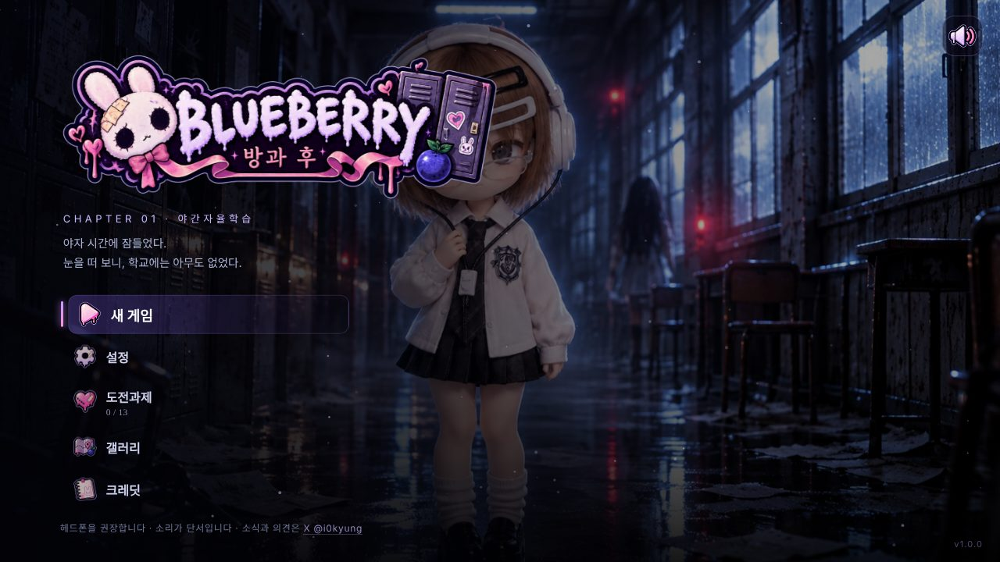
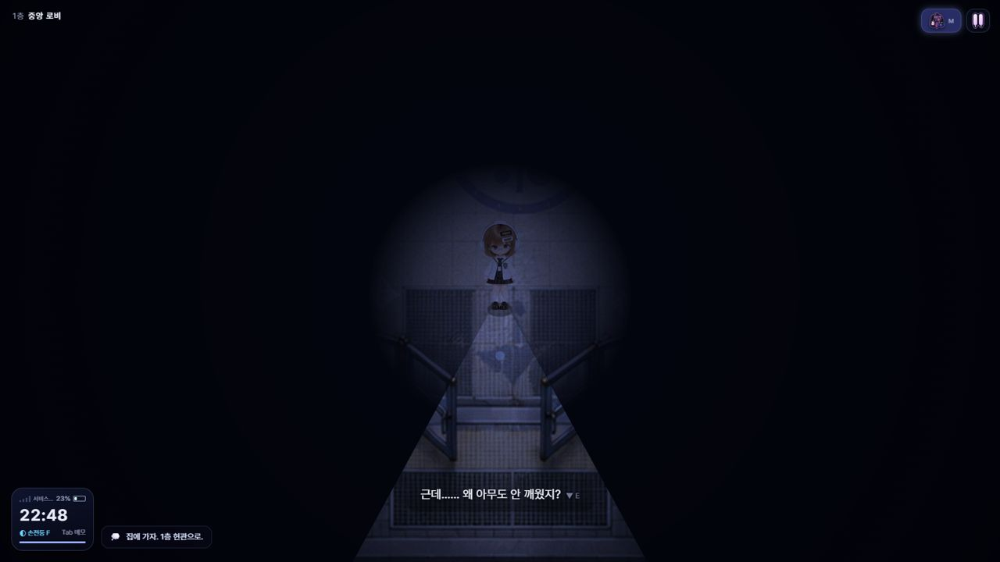
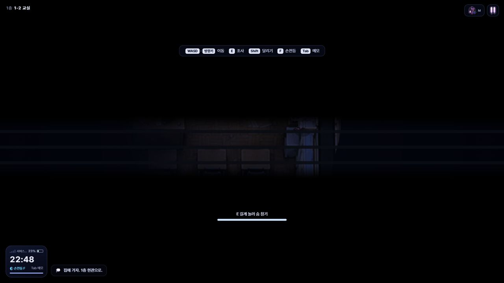
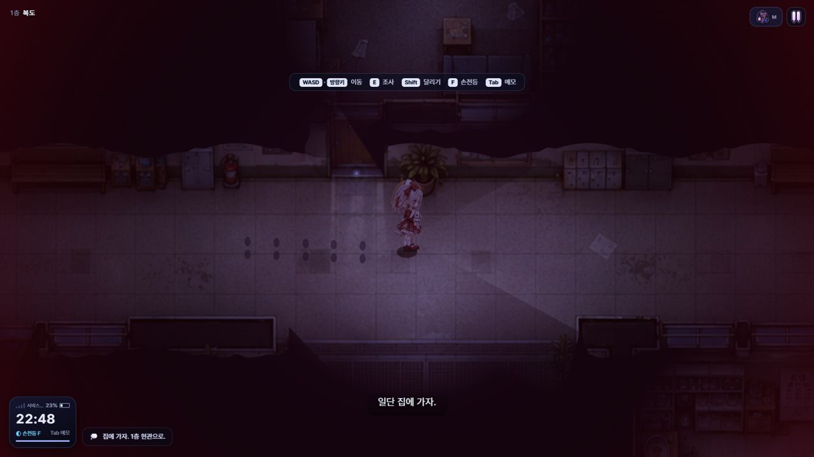
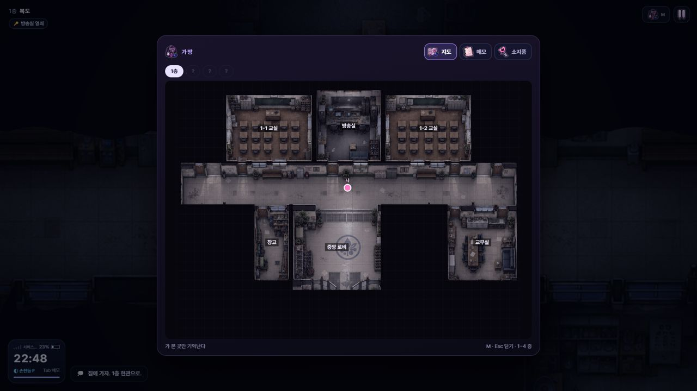
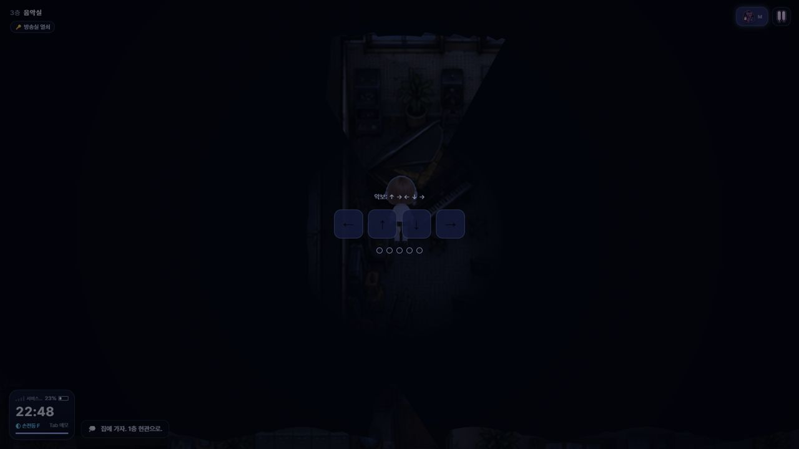
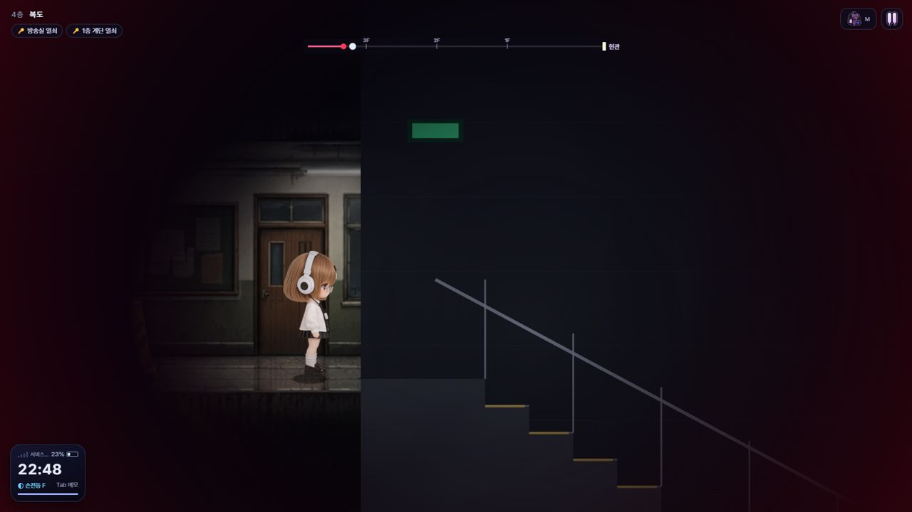

# BLUEBERRY 방과 후 · CHAPTER 01 「야간자율학습」

> 야자 시간에 잠들었다.
> 눈을 떠 보니, 학교에는 아무도 없었다.

위에서 내려다보는 시점으로 진행하는 **추격형 탈출 공포 게임**입니다.
설치 없이 PC·휴대폰 브라우저에서 바로 할 수 있어요. 키보드, 게임패드, 터치를 모두 지원합니다.
**휴대폰은 가로로 들고** 플레이해 주세요. 헤드폰을 끼면 훨씬 무서워요.

**바로 하기:** https://i0kyung.github.io/blueberry-afterschool/

## 어떤 게임인가요

- 블루베리 마법학교 1층 교실에서 혼자 깨어납니다. 22:48, 배터리 23%, 서비스 없음.
- 게임은 **목적지를 알려 주지 않아요.** 주인공이 휴대폰 메모에 적는 혼잣말과, 먼저 갇혔던 누군가가 남긴 기록을 따라가며 직접 길을 찾습니다.
- 그것(인형 소녀)은 잘 보이지 않습니다. 대신 **소리로 거리를 알려요.** 멀리 있으면 희미한 오르골 소리, 가까워지면 딸깍거리는 구두 소리, 아주 가까우면 숨소리가 들립니다. 헤드폰을 권장해요.
- 사물함, 캐비닛, 화장실 칸에 숨을 수 있어요. 그것이 바로 앞에 멈추면 **숨을 참아야** 합니다. 너무 오래 참으면 숨이 터져요.
- 1층부터 4층까지, 층마다 다른 이야기가 기다리고 있어요. 마지막엔 옥상에서 현관까지 쉬지 않고 뛰어 내려가야 합니다.

| | |
| --- | --- |
|  |  |
|  |  |
|  |  |

## 조작

| 동작 | 키보드 | 게임패드 | 터치 |
| --- | --- | --- | --- |
| 이동 | WASD · 방향키 | 왼쪽 스틱 · 십자키 | 왼쪽 아래 방향 패드 (바깥까지 밀면 달리기) |
| 조사 · 숨기 · 대사 넘기기 | E · Space | Ⓐ | 조사 버튼 · 화면 터치 |
| 숨 참기 | 숨은 채로 E 길게 | Ⓐ 길게 | 조사 버튼 길게 |
| 달리기 (발소리가 커져요) | Shift | LB · RB · LT · RT | 달리기 버튼 |
| 손전등 | F | Ⓧ | 손전등 버튼 |
| 가방 (지도 · 메모 · 소지품) | M | Ⓨ · View | 오른쪽 위 가방 |
| 휴대폰 메모 | Tab | Ⓑ | 왼쪽 아래 휴대폰 |
| 일시정지 | Esc | Menu | 오른쪽 위 ⏸ |

메뉴는 마우스, 방향키, 게임패드 어느 쪽으로든 움직일 수 있어요.

## 기능

- **자동 저장 · 이어하기**: 층에 도착하거나 중요한 단서를 얻을 때마다 이 브라우저에 자동 저장됩니다(오른쪽 아래 블루베리가 돌아가요). 타이틀에서 「이어하기」를 누르면 마지막 체크포인트부터 시작해요.
- **설정**: 전체 · 음악 · 효과음 볼륨, 밝기(블루베리가 겨우 보일 만큼 맞추기), 화면 흔들림, 필름 노이즈, 번쩍임 줄이기, 소리 자막, 대사 크기, 전체 화면. 게임 중에도 일시정지 메뉴에서 바꿀 수 있어요.
- **접근성**: 처음 켤 때 점프스케어 · 번쩍임 경고가 나오고, 「번쩍임 줄이기」를 켜면 잡혔을 때 깜빡이는 연출이 부드러워집니다. 「소리 자막」을 켜면 오르골 소리의 거리, 노크, 키득거림 같은 중요한 소리를 글자로도 보여 줘요.
- **도전과제 13개**: 달성하면 오른쪽 위에 알림이 떠요. 몇 개는 숨겨져 있습니다.
- **결과 화면 · 크레딧**: 클리어하면 플레이 시간, 잡힌 횟수, 숨은 횟수, 메모 수로 랭크(S~C)를 매겨요.
- **갤러리**: 키 아트와 등장인물 그림을 모아 볼 수 있어요. 일부는 클리어 후에 열립니다.
- **학생 6명**: 누구를 골라도 이야기는 같아요. 여섯 명 모두로 클리어하면 도전과제가 있습니다.

### 도전과제 (숨겨진 것 제외)

| 이름 | 조건 |
| --- | --- |
| 숨바꼭질 | 처음으로 몸을 숨겼다 |
| 숨죽여 | 그것이 바로 앞에 있을 때 숨을 참았다 |
| 불을 켜다 | 복도 배전반을 올렸다 |
| 첫 번째 술래잡기 | 첫 추격에서 살아남았다 |
| 신호 한 칸 | 도서관 창가에서 신호를 찾았다 |
| 방과 후 | CHAPTER 01을 끝까지 봤다 |
| 들키지 않은 아이 | 한 번도 잡히지 않고 클리어 |
| 막차 | 25분 안에 클리어 |
| 기록광 | 휴대폰 메모를 14개 이상 남기고 클리어 |
| 전원 출석 | 여섯 학생 모두로 클리어 |

## 소식 · 의견

새 챕터 소식과 개선 의견은 X **[@i0kyung](https://x.com/i0kyung)** 에서 받아요. DM 환영합니다.

## 개발자 응원하기

학부생이 혼자 만드는 게임이에요. 작은 후원이 큰 힘이 됩니다!

- [카카오페이로 바로 송금하기](https://qr.kakaopay.com/FZ946M6xm)
- 후원 계좌: **카카오페이증권 020-07-776986**

## 만든 방법

- 빌드 도구 없이 HTML · CSS · JavaScript 파일만으로 만들었습니다. 그림은 Canvas 2D로 그려요.
- **빛과 어둠**: 지도 위에 남색 어둠을 덮고, 손전등(부채꼴)과 형광등(원)이 벽을 만나면 멈추도록 빛을 직접 계산합니다. 숨으면 틈 사이로 내다보는 시야로 바뀌어요.
- **그것의 AI**: 배회 → 의심(소음을 따라감) → 추격 → 수색(근처 숨는 곳을 확인) 상태를 오가요. 숨는 걸 들키거나 같은 곳에 연달아 숨으면 그곳부터 열어 봐요. 길 찾기는 A*입니다.
- **소리**: 녹음 파일 없이 전부 Web Audio로 실시간 합성합니다. 오르골, 피아노, 발소리, 숨소리, 심장 소리, 형광등 소리까지 코드로 만들고, 그것과의 거리와 방향에 따라 크기와 좌우를 바꿔요.
- **문**: 지도에 그려진 문 40개가 다가가면 안쪽으로 열리고, 지나가면 닫혀요. 잠긴 문은 열리지 않고 자물쇠와 「잠겨 있다」가 떠요. 그것이 문을 열면 멀리서도 끼이익 소리가 납니다.
- **휴대폰**: 세로로 들면 가로로 돌려 달라는 화면이 뜨고 게임이 멈춰요. 시작할 때 전체 화면·가로 고정을 시도하고(안드로이드), 왼쪽 아래 방향 패드와 오른쪽 빨간 테두리 버튼(조사·달리기·손전등·가방)으로 조작해요. 패드를 바깥까지 밀면 달리기.
- **공포 디렉터**: 첫 숨기 이후, 조용할 때만 가끔 무언가가 일어나요. 손전등 끝을 스쳐 지나가는 그림자, 어둠 속에서 뜨이는 붉은 눈, 등 뒤를 한 바퀴 도는 구두 소리, 꺼졌다 켜지는 형광등, 휴대폰 시계 글리치 같은 것들이에요. 같은 이벤트는 연달아 나오지 않고, 추격 직후에는 숨 돌릴 틈을 줍니다.
- **그것의 연출**: 어둠 속에서도 붉은 눈이 보여서 다가오는 방향을 알 수 있어요. 쫓아올 때는 스톱모션처럼 뚝뚝 끊기며 걷고, 가끔 고개가 꺾여요. 숨어 있으면 바로 앞에서 「어디 숨었어……?」 하고 속삭입니다. 가까이 오면 손전등이 떨리고, 추격 중에는 화면이 찢어지듯 흔들려요.
- **소리 공간감**: 복도 잔향을 합성해 넣었고, 숨으면 바깥 소리가 벽 너머처럼 먹먹하게 들려요.
- **고화질**: 지도, 캐릭터·그것의 걷기 그림, 점프스케어 그림을 AI 초해상도(EDSR ×2)로 두 배 크기로 다시 만들었어요.
- **마지막 추격**: 옥상에서 현관까지는 옆에서 본 화면으로 바뀌어, 방과 계단을 이어 붙인 코스를 장애물을 넘으며 달립니다.

### 파일

- `index.html` — 화면 구성과 스타일
- `game.js` — 탑뷰 게임 본체 (지도 · 빛 · 그것의 AI · 이야기 · 소리)
- `runner.js` — 마지막 추격 (옆모습 달리기)
- `doors.js` — 문 열림·닫힘·잠김 연출
- `mobile.js` — 휴대폰 가로 플레이 (회전 안내 · 방향 패드 · 터치 버튼)
- `horror.js` — 공포 연출 · 애니메이션 레이어 (공포 디렉터 · 그것의 눈 · 속삭임 · 화면 효과 · 잔향)
- `meta.js` — 게임 바깥 레이어 (설정 · 저장 · 도전과제 · 게임패드 · 메뉴 · 결과 · 크레딧 · 갤러리)
- `img/` — 지도, 캐릭터, 키 아트, UI 아이콘 · `img/gallery/` 갤러리 그림 · `img/og.jpg` 링크 미리보기
- `sprites/` — 캐릭터와 그것의 4방향 걷기 그림
- `docs/screens/` — 이 README에 쓰는 스크린샷

### 개발용 주소

- `?dev&f=2` — 2층부터 바로 시작 (1~4)
- `?dev&f=1&run` — 마지막 추격부터
- 개발용 주소로 하면 도전과제가 달성되지 않아요.

### GitHub Pages로 올리기

1. 이 폴더를 저장소 `blueberry-afterschool`로 올립니다.
2. 저장소 **Settings → Pages**에서 Branch를 `main` / `/ (root)`로 고르고 Save.
3. 1~2분 뒤 `https://i0kyung.github.io/blueberry-afterschool/` 에서 열려요.

저장소 이름을 바꾸면 `index.html` 위쪽 `og:image`, `og:url` 주소도 같이 바꿔 주세요(링크 미리보기 그림).

## 글꼴과 저작권

- 본문 글꼴: **Pretendard** (SIL Open Font License 1.1), CDN으로 불러옵니다.
- 속삭임 글꼴: **나눔명조** (SIL Open Font License 1.1), Google Fonts로 불러옵니다.
- 로고, 캐릭터, 배경, 키 아트, 아이콘 등 모든 그림 © 김민경. 아래 MIT 라이선스는 코드에만 적용되고 그림에는 적용되지 않습니다.

## 라이선스

코드: MIT
